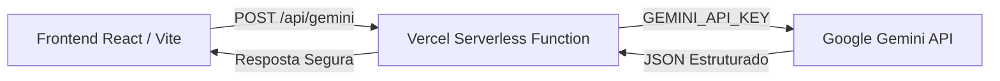

<div align="center">

# 💰 PlanejAI

**Planejador Financeiro Inteligente com IA**

PlanejAI é uma aplicação web moderna que transforma metas financeiras em planos práticos e acionáveis. Utilizando a API do **Google Gemini** através de uma arquitetura segura com **Serverless Functions na Vercel**, a ferramenta analisa a renda, despesas e dívidas do usuário para fornecer diagnósticos detalhados, projeções e sugestões personalizadas de economia, renda extra e investimentos.

---

[](https://react.dev/)
[](https://www.typescriptlang.org/)
[](https://vitejs.dev/)
[](https://tailwindcss.com/)
[](https://ai.google.dev/)
[](https://vercel.com/)

</div>

<br />

<!-- ========================================== -->
<!-- PREVIEW / CAPTURA DE TELA DA APLICAÇÃO      -->
<!-- Substitua o link abaixo pela sua imagem     -->
<!-- ========================================== -->
<div align="center">
  
  <p><em>Interface do PlanejAI: diagnóstico inteligente, histórico e simulações financeiras</em></p>
</div>

<br />

---

## 📌 Sobre o Projeto

O **PlanejAI** foi iniciado como parte do desafio prático do bootcamp **Santander 2026 - AI & React**, realizado pela **DIO (Digital Innovation One)** em parceria com o **Santander**.

O principal objetivo do projeto é democratizar a educação e o planejamento financeiro pessoal. Ao invés de lidar com planilhas complexas e cálculos manuais, o usuário informa seus dados de forma intuitiva e recebe um relatório completo gerado por Inteligência Artificial Generativa, contendo feedback realista sobre a viabilidade da sua meta e os passos exatos para atingi-la.

---

## ✨ Funcionalidades

- [x] **Simulação Financeira Completa**: Formulário intuitivo para inserção de renda mensal, despesas fixas essenciais, valor total de dívidas, meta financeira pretendida e prazo estimado.
- [x] **Diagnóstico Inteligente com Google Gemini**:
  - Avaliação de viabilidade do objetivo (_Viável_, _Requer Ajustes_ ou _Inviável_).
  - Análise aprofundada da saúde financeira com cálculos de capacidade de poupança mensal.
  - Recomendações práticas e personalizadas para corte de gastos e otimização de orçamento.
  - Estratégias para geração de renda extra.
  - Orientações introdutórias sobre investimentos alinhados ao prazo da meta.
  - Mensagem motivacional personalizada.
- [x] **Histórico Local de Simulações**: Armazenamento no navegador (`localStorage`), permitindo revisitar planejamentos anteriores a qualquer momento.
- [x] **Alternância de Tema (Dark / Light)**: Interface com suporte a tema claro e tema escuro, garantindo conforto visual e acessibilidade.
- [x] **Design Responsivo & Acessível**: Interface adaptável a qualquer dispositivo (desktops, tablets e smartphones), com skeletons de carregamento e feedback de status.

---

## 🛡️ Arquitetura & Segurança

A comunicação com o modelo de linguagem não expõe credenciais sensíveis no navegador. O projeto adota uma arquitetura em duas camadas:



1. **Frontend**: Coleta os dados da simulação e envia uma requisição para a rota interna `/api/gemini`.
2. **Backend Serverless ([api/gemini.ts](api/gemini.ts))**: Uma Vercel Serverless Function recebe a requisição, formata o prompt especializado, injeta a chave `GEMINI_API_KEY` mantida segura em variáveis de ambiente, aplica tratamento de erros/fallback e aciona o modelo Gemini.
3. **Proteção Total**: A chave da API nunca é exposta no código client-side nem no bundle final.

---

## 🛠️ Tecnologias Utilizadas

### Frontend

- **[React 19](https://react.dev/)**: Biblioteca para interfaces de usuário reativas e componentizadas.
- **[TypeScript](https://www.typescriptlang.org/)**: Tipagem estática para maior segurança e produtividade.
- **[Vite](https://vitejs.dev/)**: Ferramenta de build de alta performance e servidor de desenvolvimento ágil.
- **[React Router DOM v7](https://reactrouter.com/)**: Gerenciamento de rotas e navegação SPA.
- **[Tailwind CSS v4](https://tailwindcss.com/)**: Framework utilitário moderno para estilização rápida e responsiva.
- **[Lucide React](https://lucide.dev/)**: Pacote consistente e moderno de ícones vetoriais.
- **[React Loading Skeleton](https://github.com/dvtng/react-loading-skeleton)**: Feedback visual agradável durante requisições assíncronas.

### Backend & Inteligência Artificial

- **[Vercel Serverless Functions](https://vercel.com/docs/functions)**: Execução de código no backend sob demanda em ambiente serverless.
- **[Google Gemini API](https://ai.google.dev/)**: Modelo de linguagem de última geração para análise e geração de insights estruturados.

### Qualidade de Código & Ferramentas

- **ESLint 10** + **Prettier 3**: Padronização de código, ordenação de imports e garantia de boas práticas.

---

## 📋 Pré-requisitos

Antes de iniciar, certifique-se de ter instalado em sua máquina:

- **[Node.js](https://nodejs.org/)** (versão 20 ou superior)
- Gerenciador de pacotes **npm** (incluso com Node) ou **pnpm**
- **[Git](https://git-scm.com/)** para controle de versão
- Uma chave de API do **Google Gemini** (gratuita no [Google AI Studio](https://aistudio.google.com/))

---

## 🚀 Instalação e Execução Local

1. **Clone o repositório:**

   ```bash
   git clone https://github.com/camilafbc/react-planejai.git
   cd react-planejai
   ```

2. **Instale as dependências:**

   ```bash
   npm install
   ```

3. **Configure as variáveis de ambiente:**
   Crie um arquivo `.env.local` na raiz do projeto baseado no `.env.example`:

   ```bash
   cp .env.example .env.local
   ```

   Adicione sua chave de API e o modelo desejado (veja detalhes na seção abaixo).

4. **Inicie o servidor de desenvolvimento:**

   ```bash
   npm run dev
   ```

5. **Acesse no navegador:**
   Abra [http://localhost:3000](http://localhost:3000) para interagir com a aplicação.

---

## 📜 Scripts Disponíveis

| Comando            | Descrição                                                                   |
| :----------------- | :-------------------------------------------------------------------------- |
| `npm run dev`      | Inicia o servidor local de desenvolvimento (Vite)                           |
| `npm run build`    | Valida a tipagem TypeScript e gera a build otimizada de produção em `/dist` |
| `npm run preview`  | Pré-visualiza localmente a build de produção                                |
| `npm run lint`     | Executa o ESLint para verificar inconsistências no código                   |
| `npm run lint:fix` | Corrige automaticamente problemas identificados pelo ESLint                 |
| `npm run format`   | Formata todo o código do projeto com o Prettier                             |

---

## 📂 Estrutura do Projeto

```plaintext
planejai/
├── api/                       # Serverless Functions (Vercel)
│   └── gemini.ts              # Endpoint de integração segura com a API do Gemini
├── public/                    # Arquivos estáticos e ícones
├── src/
│   ├── assets/                # Imagens, logotipos e ilustrações
│   ├── components/            # Componentes React
│   │   ├── features/          # Componentes específicos (Formulário, Resultados, Histórico)
│   │   ├── layout/            # Layouts principais (RootLayout)
│   │   └── shared/            # Componentes visuais reutilizáveis (Button, Card, Input)
│   ├── context/               # Contextos globais da aplicação (ex: ThemeContext)
│   ├── data/                  # Prompts do Gemini e definições de simulação
│   ├── hooks/                 # Custom React Hooks (useInsight, useSimulationStorage, etc.)
│   ├── pages/                 # Páginas da aplicação mapeadas nas rotas
│   ├── services/              # Camada de serviços e comunicação com a API
│   ├── styles/                # Configurações de estilos globais e temas
│   ├── utils/                 # Funções utilitárias (formatação de moeda, cálculos)
│   ├── App.tsx                # Componente raiz
│   ├── main.tsx               # Ponto de entrada da aplicação React
│   └── router.tsx             # Definição e configuração das rotas
├── .env.example               # Exemplo de configuração de variáveis de ambiente
├── package.json               # Dependências e scripts do projeto
├── tailwind.config.js / css   # Configurações do Tailwind CSS v4
├── tsconfig.json              # Configurações do compilador TypeScript
└── vite.config.ts             # Configuração do Vite
```

---

## 📄 Licença e Agradecimentos

Este projeto foi desenvolvido para fins educacionais e portfólio durante o **Santander Bootcamp 2026 - AI & React** promovido pela [DIO](https://www.dio.me/) em parceria com o [Santander Open Academy](https://www.santanderopenacademy.com/).
